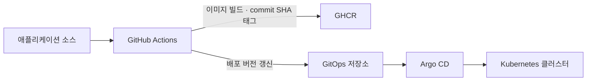
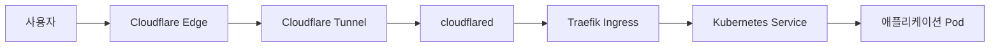

# 🏠 HomeServer PaaS

> 홈서버 Kubernetes에서 개인 애플리케이션을 빌드하고 운영하기 위한 셀프호스트 PaaS 프로젝트입니다.

자기소개 웹앱을 첫 배포 대상으로 삼고, 굶지마 MZ 관련 웹·콘텐츠 도구와 영상 제작 자동화로 확장할 기반을 만들고 있습니다.

## 🧭 운영 현황

| 영역 | 구성 | 현황 |
| --- | --- | --- |
| 홈서버 클러스터 | Ubuntu Server · `kubeadm` · `containerd` · Calico | 단일 Control Plane이 `Ready` 상태인 것을 2026-11-23에 확인했습니다. Control Plane 고가용성은 아직 없습니다. |
| 추가 Worker | 두 번째 온프레미스 호스트 | 가입 전 네트워크 검증이 남아 있어 아직 멀티 노드 운영 상태가 아닙니다. |
| 애플리케이션 배포 | GitHub Actions · GHCR · GitOps · Argo CD | 소스 commit SHA를 이미지 버전으로 연결하는 흐름을 사용합니다. |
| 외부 접속 | Cloudflare Tunnel · `cloudflared` · Traefik | 자기소개 앱 경로를 2026-11-12 작업 기록에서 확인했습니다. |
| 호스트 자동화 | Docker 기반 Ansible Controller | 설계 단계입니다. `homeServer-ansible` 저장소와 Playbook은 아직 생성되지 않았습니다. |
| 상태 저장·관측성 | StorageClass · PVC · DB · Metrics/Logs | 2026-11-21 기록 기준으로 아직 배포 전입니다. |

상태 표시는 각 항목의 마지막 확인 기록을 기준으로 합니다.

## 🏗️ 플랫폼 흐름

### 코드에서 클러스터까지

### 외부 요청 경로

배포 경로와 사용자 트래픽 경로는 분리되어 있습니다. CI는 클러스터에 직접 `kubectl apply`하지 않고, Argo CD가 GitOps 상태를 클러스터에 반영합니다.

## 📦 저장소 책임

| 저장소 역할 | 관리 내용 | 상태 |
| --- | --- | --- |
| Application | 앱 코드, Dockerfile, GitHub Actions, 컨테이너 이미지 | 자기소개 앱의 빌드·이미지 게시 workflow가 있습니다. |
| `homeServer-gitOps` | Argo CD Application, 앱 매니페스트, 클러스터 내부 구성요소 | 앱 배포의 Git 기준 저장소입니다. Organization 소유권 정리는 통합 대상입니다. |
| `homeServer-ansible` | Inventory, Playbook, Role, 호스트 준비 및 Worker 가입 | GitOps와 분리할 비공개 저장소로 계획되어 있습니다. |

GitOps 저장소는 `argocd/`에서 Application을, `apps/`에서 앱 매니페스트를, `infrastructure/`에서 클러스터 구성요소를 관리합니다. 앱·Tunnel Connector·Ingress는 Argo CD Application 단위로 나눠 자동 동기화합니다.

## 🚀 CI/CD 배포 단계

| 단계 | 작업 | 결과 |
| --- | --- | --- |
| 1. 변경 | 애플리케이션 `main`에 변경을 push | GitHub Actions 시작 |
| 2. 빌드 | Java 21과 Gradle로 Spring Boot WAR 생성 | 실행형 애플리케이션 산출물 |
| 3. 이미지 | 컨테이너 빌드 후 GHCR에 게시 | 소스 commit SHA로 버전 식별 |
| 4. 배포 선언 갱신 | GitOps Deployment의 이미지 태그 변경 | 배포 버전이 Git 이력에 기록 |
| 5. 클러스터 반영 | Argo CD가 변경을 감지해 동기화 | Kubernetes 워크로드 갱신 |
| 6. 확인 | Application 상태와 Pod rollout 점검 | 배포 결과 확인 |

**현재 자동화:** Actions가 GitOps `main`에 이미지 태그를 직접 commit합니다. Organization 통합과 함께 GHCR 소유 경로·권한을 점검하고, GitOps 변경을 PR로 검토하는 흐름으로 개선할 계획입니다.

## 🧰 Ansible 호스트 자동화

계획된 Controller는 관리 노트북에서 Docker 컨테이너로 실행합니다. Ansible Core와 실행 의존성을 컨테이너에 고정하고, SSH로 호스트를 관리합니다.

| Playbook 단계 | 역할 | 안전 경계 |
| --- | --- | --- |
| **Preflight** | SSH, OS, 디스크, sudo, 런타임, API 연결 확인 | 읽기 전용 검사. 조건이 맞지 않으면 중단 |
| **Prepare** | 선택한 Worker의 OS 전제조건, `containerd`, `kubeadm`, `kubelet` 준비 | 한 번에 Worker 한 대씩 적용 |
| **Join** | 단기 kubeadm token으로 Worker 가입 | 선택한 호스트만 변경하고 token은 로그에 남기지 않음 |
| **Verify** | Node `Ready`, 주소, Calico Pod와 노드 간 통신 확인 | 자동 reset·재가입 없이 결과 보고 |

Ansible은 Control Plane 설정, 방화벽, Netplan, Calico 설치를 임의로 바꾸지 않습니다. Kubernetes 앱과 클러스터 리소스는 계속 GitOps와 Argo CD가 관리합니다.

## 🌐 네트워크와 보안

- Calico CNI가 Pod 네트워크를 제공하고, VXLAN으로 서로 다른 노드의 Pod 통신을 지원합니다. Worker 가입 후 Node 주소 선택과 실제 통신을 검증합니다.
- Cloudflare Tunnel은 Connector가 먼저 외부로 연결을 만드는 방식입니다. 홈서버의 인바운드 포트를 인터넷에 직접 공개하지 않습니다.
- Argo CD 관리 API는 클러스터 내부 `ClusterIP`로 유지합니다. 앱 요청은 Argo CD를 통과하지 않습니다.
- SSH 키, kubeconfig, Kubernetes 인증서, join token, DB 비밀번호, Cloudflare token은 Git에 저장하지 않습니다. Actions와 저장소 권한은 필요한 범위로 제한합니다.
- 내부 주소와 접속 세부 정보는 공개 프로필에 기록하지 않으며, 호스트·클러스터 구성이 포함될 수 있는 저장소는 비공개를 우선 검토합니다.

## 💾 스토리지 · 관측성 · 복구

| 영역 | 현재 상태 | 확장 방향 |
| --- | --- | --- |
| 영구 저장소 | StorageClass/PVC 미도입 | 로컬 영구 볼륨과 데이터 수명주기를 정한 뒤 DB 배포 |
| 데이터베이스 | 아직 배포 전 | DB 자체 백업과 복원 절차를 etcd 백업과 분리 |
| 메트릭 | 관측성 저장소 미도입 | Metrics Server부터 시작해 Prometheus·Grafana·Alertmanager 검토 |
| 로그 | 중앙 로그 저장소 미도입 | Alloy와 Loki를 자원·저장 용량에 맞춰 단계적으로 추가 |
| 백업 | 구현·복원 검증 전 | etcd·재구성 자료·Git 외부 Secret을 암호화해 홈서버 밖에 보관 |

DB 도입 후에는 데이터 백업과 WAL 보관을 추가하고, 복원 연습으로 실제 복구 가능성을 확인합니다. Worker나 관측성 도구를 추가해도 단일 Control Plane과 단일 로컬 저장소의 고가용성이 보장되지는 않습니다.

## 🗺️ 다음 단계

1. 추가 Worker의 SSH/API 경로와 Calico 주소를 검증하고 한 대씩 가입합니다.
2. `homeServer-ansible` 저장소를 만들고 Preflight부터 자동화를 검증합니다.
3. 저장소 소유권, GHCR 권한, GitOps PR 기반 배포 경로를 Organization 기준으로 정리합니다.
4. 영구 스토리지와 DB 도입 시 백업 위치·보존 기간·복원 절차를 함께 검증합니다.
5. 자원 사용량을 측정해 메트릭·로그를 추가하고, 필요할 때 AWS EC2 Worker 확장을 검토합니다.
