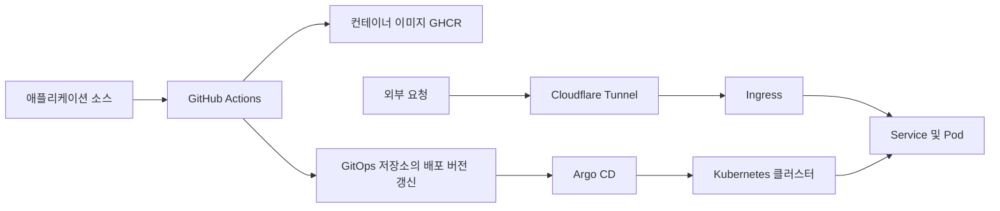

# HomeServer PaaS

홈서버 Kubernetes 클러스터를 기반으로 애플리케이션을 배포하고, 인프라와 운영 변경을 코드로 관리하는 홈랩 프로젝트입니다. 애플리케이션 개발부터 이미지 빌드, GitOps 배포, 외부 요청 전달까지 이어지는 흐름을 만들고 있습니다.

자기소개 웹 애플리케이션과 여러 실험용 서비스, 콘텐츠 제작 도구를 안정적으로 실행할 수 있는 기반을 목표로 합니다. 현재는 개인 홈랩에서 플랫폼의 구성과 운영 방식을 단계적으로 다듬고 있습니다.

## 플랫폼 흐름

- **애플리케이션 저장소**는 소스 코드와 컨테이너 빌드 및 CI 흐름을 관리합니다.
- **GitOps 저장소**는 Argo CD Application과 Kubernetes 배포 선언을 관리합니다.
- **호스트 자동화**는 Ansible을 활용해 서버 준비와 클러스터 노드 구성을 반복 가능하게 만드는 방향으로 확장합니다.
- **외부 요청 경로**는 Cloudflare Tunnel과 Ingress를 통해 클러스터 안의 서비스로 연결합니다. Argo CD는 배포 상태를 관리하며 사용자 요청 경로에는 포함되지 않습니다.

## 운영 원칙

- 애플리케이션 코드, 서버 구성, Kubernetes 배포 상태를 각자의 책임에 맞게 나눕니다.
- 비밀값과 자격 증명은 Git에 저장하지 않고, 필요한 작업에 최소 권한만 부여합니다.
- 배포할 이미지 버전을 Git에서 추적하고, Argo CD가 선언된 상태를 클러스터에 반영하도록 합니다.
- 스토리지, 백업, 관측성, 하이브리드 노드 구성은 운영 요구와 검증에 맞춰 단계적으로 확장합니다.

## 프로젝트 방향

홈서버에서 여러 애플리케이션을 지속적으로 운영할 수 있도록 배포 자동화와 복구 절차를 개선하고 있습니다. 저장소별 실행 방법과 구성 세부 사항은 각 프로젝트 저장소의 README에서 관리합니다.
