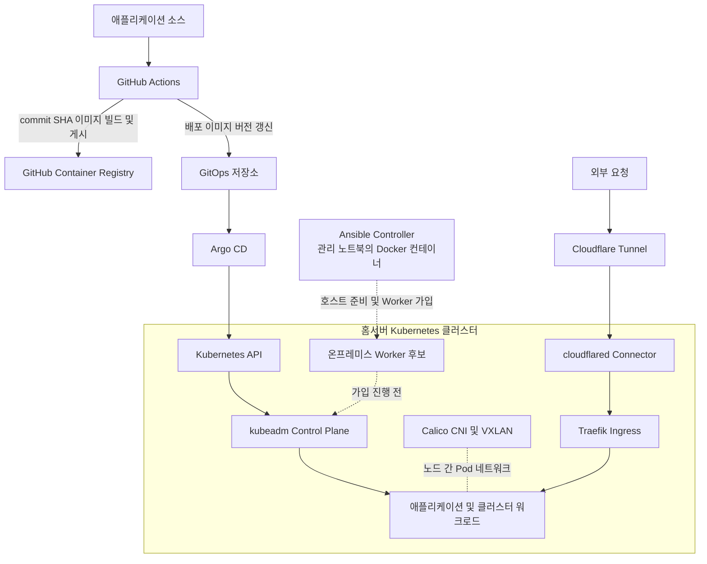

# HomeServer PaaS

HomeServer PaaS는 홈서버 Kubernetes 클러스터에서 애플리케이션을 실행하고, 호스트 구성부터 배포와 복구까지의 운영 과정을 코드로 관리하는 홈랩 프로젝트입니다. 개인 프로젝트를 안정적으로 배포할 수 있는 작은 PaaS를 만들며, 실제 운영에서 확인한 내용과 아직 설계 중인 항목을 구분해 확장합니다.

대표 워크로드는 자기소개 웹 애플리케이션입니다. 굶지마 MZ 관련 웹·콘텐츠 도구와 영상 제작 자동화도 플랫폼에 올릴 실험 대상으로 다룹니다.

## 플랫폼 구조

### 홈서버와 Kubernetes

홈서버는 Ubuntu Server 기반의 온프레미스 미니 PC로 구성합니다. Kubernetes는 `kubeadm`으로 설치하고, `containerd`를 컨테이너 런타임으로, Calico를 Pod 네트워크로 사용합니다. Calico VXLAN은 여러 노드에 배치된 Pod 사이의 통신을 담당하도록 구성합니다.

| 영역 | 구성과 책임 | 최근 문서 확인 기준 |
| --- | --- | --- |
| Control Plane | `kubeadm` 기반 단일 Control Plane과 로컬 `etcd` | 2026-11-23에 노드 `Ready` 확인. Control Plane 고가용성은 아직 제공하지 않습니다. |
| Worker | 추가 온프레미스 호스트를 기존 클러스터에 편입 | 첫 Worker의 가입 전 네트워크 검증이 남아 있습니다. 아직 멀티 노드 운영 상태로 간주하지 않습니다. |
| Pod 네트워크 | Calico CNI, 노드 간 VXLAN 통신 | Worker 가입 후 Node 주소 선택과 Pod 간 통신을 검증합니다. |
| 외부 진입 | Cloudflare Tunnel, `cloudflared`, Traefik Ingress | Tunnel을 통한 자기소개 앱 경로가 2026-11-12 작업 기록에서 확인됐습니다. |
| 상태 저장 서비스 | StorageClass, PVC, 데이터베이스 | 2026-11-21 확인 기록에서는 아직 배포 전 단계였습니다. |

단일 Control Plane은 Control Plane 장애 시 Kubernetes API와 자동 복구 기능이 제한됩니다. Worker를 추가하는 것만으로 Control Plane의 고가용성이 생기지는 않습니다.

## 저장소 책임 경계

플랫폼은 애플리케이션 개발, Kubernetes의 원하는 상태, 호스트 자동화의 세 수명주기로 나눕니다. 저장소 소유권과 Organization 경로는 이 역할에 맞춰 정리하는 중입니다.

| 저장소 역할 | 책임 | 현황 |
| --- | --- | --- |
| Application | 애플리케이션 코드, Dockerfile, GitHub Actions, 이미지 빌드 | 자기소개 앱의 빌드 및 이미지 게시 workflow가 있습니다. |
| `homeServer-gitOps` | Argo CD Application, 앱 Deployment/Service/Ingress, 클러스터 내부 구성요소 | 앱 배포의 Git 기준 저장소입니다. Organization 소유권과 연결 정보는 통합 대상입니다. |
| `homeServer-ansible` | Inventory, Playbook, Role, 호스트 준비와 Worker 가입 | GitOps와 분리한 비공개 저장소로 만들 계획이며 아직 생성되지 않았습니다. |

## 애플리케이션 CI/CD와 GitOps

애플리케이션을 만드는 CI와 Kubernetes에 배포하는 CD를 나눕니다. 현재 기록된 자기소개 앱 흐름은 다음과 같습니다.

1. 애플리케이션 저장소의 `main` 변경으로 GitHub Actions를 실행합니다.
2. Java 21과 Gradle로 Spring Boot 실행형 WAR를 빌드합니다.
3. 컨테이너 이미지를 빌드해 GHCR에 게시하고, 이미지 태그에 소스 commit SHA를 사용합니다.
4. Actions가 GitOps 저장소의 Deployment 이미지 태그를 새 버전으로 갱신합니다.
5. Argo CD가 GitOps 저장소의 선언 상태를 읽어 Kubernetes 클러스터에 반영합니다.
6. Argo CD의 Application 상태와 애플리케이션 rollout을 확인합니다.

CI가 클러스터에 직접 `kubectl apply`하지 않습니다. GitOps 저장소는 `argocd/`에 Application 정의를, `apps/`에 애플리케이션 매니페스트를, `infrastructure/`에 클러스터 내부 구성요소를 둡니다. 앱, Tunnel Connector, Ingress는 각 Argo CD Application으로 관리하고 자동 동기화와 self-heal을 사용합니다.

현재 워크플로는 이미지 태그를 GitOps `main`에 자동 commit하는 방식입니다. Organization으로 저장소를 통합할 때 GHCR 소유 경로와 권한을 확인하고, 직접 push를 검토 가능한 PR 방식으로 바꾸는 일을 후속 작업으로 둡니다.

## Ansible 호스트 자동화

Ansible은 서버 준비와 Kubernetes Worker 가입을 담당하고, 애플리케이션 및 클러스터 리소스 배포는 GitOps와 Argo CD가 담당합니다. 두 도구의 변경 범위를 분리해 호스트 설정 변경이 앱 배포 설정과 섞이지 않도록 합니다.

계획된 실행 구조는 관리 노트북에서 Docker 기반 Ansible Controller를 실행하는 방식입니다. Ansible Core와 실행 의존성을 Controller 컨테이너에 고정하고, SSH로 대상 호스트에 접속합니다. `homeServer-ansible`은 GitOps와 분리할 별도 비공개 저장소로 계획되어 있으며, 아직 프로젝트 저장소는 생성되지 않았습니다.

예정된 Worker 절차는 다음과 같습니다.

1. **Preflight:** SSH, OS, 디스크, sudo, 런타임 상태와 Control Plane API 연결을 읽기 전용으로 확인합니다. 사전 조건이 맞지 않으면 중단합니다.
2. **Prepare:** 선택한 Worker 한 대에 공통 OS 전제조건, 호환되는 `containerd`, `kubeadm`, `kubelet`을 준비합니다.
3. **Join:** 짧은 만료 시간의 kubeadm bootstrap token을 사용해 선택한 Worker만 클러스터에 가입시킵니다. 토큰과 join 명령은 로그에 남기지 않습니다.
4. **Verify:** Node의 `Ready` 상태, InternalIP, Calico 구성요소와 노드 간 Pod 통신을 확인합니다.

이 자동화는 Control Plane 설정을 변경하거나 방화벽·Netplan을 임의로 수정하지 않습니다. Calico를 다시 설치하지도 않습니다. Worker 가입 전에 필요한 네트워크 경로와 주소 선택을 확인하며, 가입 실패 때 자동 reset이나 재가입을 시도하지 않는 방향으로 설계합니다.

## 네트워크와 보안 경계

- 외부 요청은 Cloudflare Edge에서 기존 Tunnel 연결을 거쳐 `cloudflared` Connector, Traefik Ingress, Kubernetes Service와 Pod로 전달됩니다. 홈서버에 인터넷 인바운드 포트를 직접 공개하는 방식은 사용하지 않습니다.
- 앱 트래픽과 관리 트래픽을 분리합니다. Argo CD 관리 API는 클러스터 내부 `ClusterIP`로 유지하고 공개 앱 요청의 경로에 포함하지 않습니다.
- 애플리케이션 코드, Ansible 호스트 설정, Kubernetes 배포 선언은 역할별 저장소로 관리합니다.
- SSH 키, kubeconfig, Kubernetes 인증서, join token, DB 비밀번호, Cloudflare token 등 비밀값은 Git에 넣지 않습니다. Actions 권한과 저장소 접근은 필요한 범위로 제한합니다.
- 인프라 매니페스트와 호스트 정보가 포함될 수 있는 저장소는 비공개를 우선으로 검토합니다. 공개 프로필과 공개 저장소에는 내부 주소와 접속 세부 정보를 기록하지 않습니다.

## 스토리지, 관측성, 백업

상태 저장 기능은 클러스터 운영 기반을 확인한 뒤 추가합니다. 최근 확인 노트에서는 StorageClass와 PVC, 애플리케이션 DB 및 관측성 저장소가 아직 배포되지 않았습니다.

- **스토리지와 DB:** 영구 볼륨 설계와 데이터베이스 배포를 별도 단계로 진행합니다. DB 데이터는 etcd snapshot이나 Pod 복제에 의존하지 않고 자체 백업과 복원 절차를 둡니다.
- **관측성:** Metrics Server로 시작해 Prometheus, Grafana, Alertmanager를 검토하고, 로그 수집은 Alloy와 Loki를 단계적으로 추가하는 방향입니다. 저장 용량과 노드 자원 예산을 정하기 전에는 이를 운영 중인 서비스로 간주하지 않습니다.
- **백업:** 현재 우선 대상은 Control Plane의 etcd, 재구성 정보, Git 외부 Secret입니다. 백업 사본은 두 홈서버와 분리된 저장소에 암호화해 보관하고 복원 연습으로 유효성을 확인하는 계획입니다. DB 도입 후에는 DB 백업과 WAL 보관을 별도로 추가합니다.
- **가용성 한계:** Worker와 관측성 스택을 추가해도 단일 Control Plane이나 단일 로컬 저장소가 자동으로 고가용성이 되지는 않습니다. 장애 감지와 복구 시간은 실제 복원 훈련으로 확인합니다.

## 다음 단계

1. 추가 Worker의 SSH 및 Kubernetes API 경로, Calico가 사용할 Node 주소를 확인하고 한 대씩 안전하게 가입합니다.
2. `homeServer-ansible`을 별도 저장소로 만들고 Preflight부터 검증하며 자동화를 적용합니다.
3. 저장소를 Organization 기준으로 정리하고, CI의 GHCR 권한과 GitOps 이미지 갱신 절차를 최소 권한 및 PR 기반으로 개선합니다.
4. 영구 스토리지와 DB를 도입할 때 백업 목적지, 보존 기간, 복원 순서를 함께 정하고 실제 복원을 검증합니다.
5. 자원 사용량을 측정한 뒤 메트릭·로그 수집을 추가합니다. AWS EC2 Worker는 온프레미스 자원 한계를 확인한 이후의 하이브리드 확장 선택지로 검토합니다.
